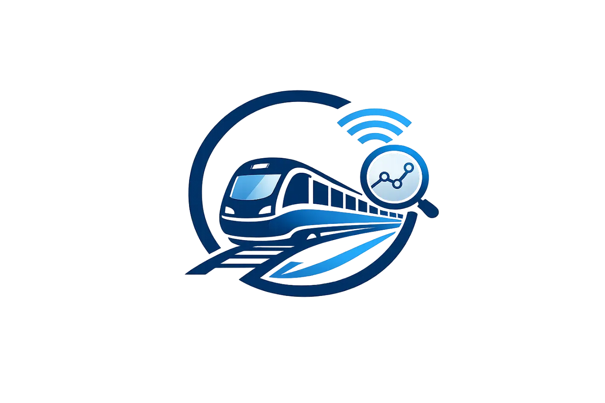

# Sistema de Monitoramento Ferroviario
## Equipe
Lucas de Tofol de Almeida
Heron Machado Soares
João Vitor Batista
Rafael Batistella Neitzel
## O que o sistema faz
O Ferrohub surgiu com a proposta de corrigir um problema presente no nosso cotidiano: A dificuldade de localizar trens, onde muitas pessoas dependem diariamente de estradas que atuam em conjunto com ferrovias, e que constantemente são utilizadas por trens sem um aviso prévio, ocasionando em possíveis chegadas tardias de pessoas em seus locais de trabalho.

O projeto permite o cadastro de usuários separados por 3 categorias, sendo elas: Usuário comum, Operador, Admin. Além disso, o sistema tem como principal funcionalidade a consulta de trens, seus horarios e demais característica através de sensores implantados internamente e externamente do trem. com eles, é possivel coletar informações como Estado do motor, temperatura interna, sistema de freios, nível de combustível, etc....

## Tecnologias
PHP, MySQL, HTML, CSS, JavaScript. Ambiente: XAMPP.
## Como instalar
1. Copiar a pasta para htdocs 
2. Iniciar Apache e MySQL no XAMPP
3. Importar banco/script.sql pelo phpMyAdmin
4. Acessar http://localhost/
## Usuarios de teste
admin senha: admin / admin@admin.com
operador senha: 123456 / lucas_t_almeida@estudante.sesisenai.org.br
usuario comum senha: 123 / joao_batista6@estudante.sesisenai.org.br
(um de cada perfil que o sistema tiver)
## Telas do sistema
dashboard - Painel principal, que informa a contagem de trens por status, alertas ativos por severidade, sensosres com leitura crítica, viagens em andamento e velocidade média da frota
formulario - Um formulário onde permite o cadastro e edição de locomotivas
home - Página inicial do site após o login, que permite o usuário se deslocar para outras páginas
inicial - Tela inicial, que permite login e sigin
leitura - Exibe alertas detectados pelos sensores
locomotivas - Tela que permite o cadastro de trens, visualizar a frota, navegar para o formulário e criação, edição e delete de registros existentes
login - Permite o login de usuários através de nome e senha
relatorios - Tela que exibe um relatorio com indicadores operacionais de uma locomotiva expecífica
sensores - Administra os sensores, permitindo visualizar suas últimas leituras, cadastrar novos dispositivos, editar e excluir registros
sigin - Tela de criação de usuários
usuarios - Tela que exibe todos os usuários
## Decisoes tomadas
Dashboard: Foi escolhido para centralizar os principais indicadores operacionais, permitindo acompanhar rapidamente a situação da frota, os alertas e as viagens em andamento.
Formulário: Foi desenvolvido para padronizar o cadastro e a edição das locomotivas, facilitando o gerenciamento das informações.
Home: Foi definida como página principal após o login, oferecendo acesso organizado às funcionalidades do sistema.
Inicial: Foi criada como porta de entrada do sistema, permitindo que o usuário acesse as opções de login e cadastro.
Leitura: Foi implementada para apresentar os alertas identificados pelos sensores, facilitando a identificação de possíveis problemas operacionais.
Locomotivas: Foi escolhida para centralizar o gerenciamento da frota, permitindo cadastrar, visualizar, editar e excluir locomotivas.
Login: Foi desenvolvido para garantir o acesso dos usuários cadastrados por meio de autenticação com nome e senha.
Relatórios: Foi criado para apresentar indicadores operacionais de locomotivas específicas, auxiliando no acompanhamento e na análise de desempenho.
Sensores: Foi desenvolvido para administrar os dispositivos IoT, permitindo acompanhar as últimas leituras e realizar operações de cadastro, edição e exclusão.
Signin (Cadastro): Foi implementado para permitir a criação de novos usuários, possibilitando o acesso ao sistema.
Usuários: Foi criada para centralizar a visualização dos usuários cadastrados, facilitando a administração das contas do sistema.

## Limitacoes conhecidas
-Não foi implementado um mapa tipo google maps por conta da dificuldade que é de colocar no programa.
-Uma das telas não foi possível terminar (relatórios), não conseguimos por conta da complexidade, tempo e organização.
-Teriamos uma tela especifica para criação de usuários para os admins criarem contas de operadores porém não conseguimos também.

## Uso de inteligencia artificial
Grande parte do sistema foi montado com o auxilio da Inteligência Artificial porém sendo ultilizado toda a lógica de programação.

Boa parte da parte de depuração, achar e solucionar bugs foram feitos com auxilio de IA

## Consideração final
Commit final. SA finalizada, agradeço a todos que me acompanharam nessa trajetória e momento. Que Deus tenha piedade de nosso trabalho.